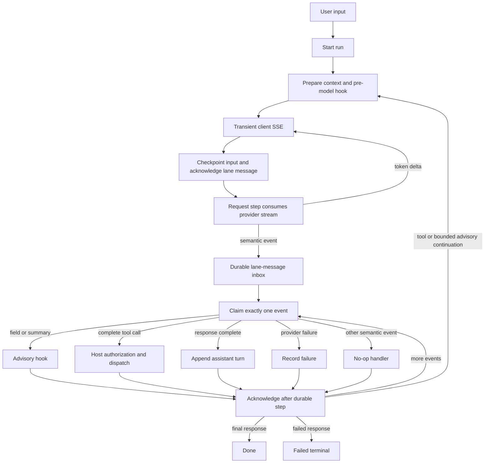

# ADR-021: Graph-Native Streaming Agent

**Status:** Accepted; opt-in implementation in progress
**Decision date:** 2026-10-23

## Context

Kogwistar has two existing agent patterns that must remain unchanged: the
conversation/RAG turn and goal-oriented workflows. A third pattern is needed
for providers that stream response events, expose completed structured fields,
and may request host-authorized tools. Token streaming is useful to clients,
but making every token a graph node would create noisy, expensive history.

## Decision

Implement the streaming loop as an opt-in ordinary Kogwistar workflow. A model
request is one workflow operation. It consumes the provider stream, forwards
token deltas transiently, and persists semantic events through the existing
lane-message inbox. The workflow then claims and handles one durable event at a
time. A separate acknowledgement step runs only after the event's handler step
has been persisted. `LaneMessagingService` supplies stable message IDs,
idempotent publication, leases, claims, acknowledgements, and requeue/dead-letter
operations.

The workflow design remains in `workflow_engine`; run and step execution
artifacts remain in `conversation_engine`. Semantic event messages are
conversation-graph artifacts, not user/assistant transcript turns. The lane
message service links each event to its run; the event journal adds a causal
`handled_by_step` edge to the handling execution step. The existing
`workflow_node_id` metadata on execution records identifies the design node.

## Event and recovery contract

- Provider contracts and normalized events are versioned `v1` Pydantic models.
- Provider response ID, provider sequence, durable message/event ID, workflow
  step sequence, and client SSE sequence are distinct fields.
- Text deltas are never written to the graph. Semantic events (response start,
  completed structured fields, summaries, completed tool calls, completion, and
  failure) use the durable inbox.
- Inbox publication uses an idempotency key derived from run/response/provider
  event coordinates and canonical event content. Repeated publication of the
  same event returns the existing message. Its durable envelope uses a stable
  provider-response producer locator and separately records the first producer
  step sequence/attempt and span coordinates. Those attempt-local fields are
  excluded from provider-event replay equivalence, so a retry reuses the first
  durable envelope without losing its origin. Once the producer step exists,
  the event is linked to it with `emitted_by_step`; handling has its own
  `handled_by_step` edge.
- The event is claimed with a lease, handled, linked to its handling step, and
  acknowledged in a later step. A crash before acknowledgement redelivers it.
  Handlers must be idempotent; tool dispatch receives a stable key derived from
  run, provider, response, and provider call ID. Final-turn and failure-record
  callbacks also receive effect-scoped keys derived from the durable event ID;
  the host must honor them before acknowledgment. Ambiguous tool failures are
  dead-lettered rather than automatically replayed. Requeue diagnostics store
  only an error code and exception class, not exception text.
- A crash while the provider itself is streaming is not equivalent to a
  resumable response. Provider adapters may report failure; recovery starts a
  new provider request only through an explicit workflow transition.
- Telemetry uses the runtime `TraceContext` and `EventEmitter` where present.
  Telemetry is best effort; graph events and runtime checkpoints are the
  recovery source of truth. The opt-in run-event API projects bounded trace,
  provider, and workflow correlation fields from durable event payloads so an
  operator can correlate SSE/run events with graph and runtime traces.
  Hosts that want provider request lifecycle visibility in run inspection/SSE
  pass the run service's `publish_semantic_event` callback as
  `publish_trace_event` when registering the workflow. This emits request
  started/completed/failed and event-persisted records with correlation
  metadata; publication is best-effort and never controls provider execution.

## Authority and hooks

Hooks are bounded advisory callbacks. Their JSON annotations are size-checked
and cannot modify `authority_context`. A tool event is only a request. The
injected host dispatcher must perform catalog lookup, ACL/scope checks, and
effective-capability authorization immediately before execution. Provider tool
schemas, hook output, and persisted workflow state are not authorization
evidence. Codex App Server's own tools are not Kogwistar tools and are not
mapped to Kogwistar dispatch.

`CatalogAuthorizedToolDispatcher` is the reusable first-party implementation
for trusted in-process providers. Its model-visible tool-name map and
capability-requirement map are host-owned. It requires an ACL-enabled catalog,
checks the request-bound principal/security/tenant/project scope, reads grants
only from `StepContext.authority_context`, verifies the provider remains
registered, and validates JSON output. Descriptor capability claims are never
used as grants. This component does not sandbox provider code and must not be
used to execute untrusted MCP/plugin code in-process.

Tool dispatch has a stable idempotency key scoped to the provider response.
`NamedProjectionToolCallIdempotency` is the first-party durable executor: it
uses the host-selected `NamedProjectionStore` CAS to persist an `executing`
record before invocation and the JSON result afterward. A completed retry
returns the recorded result; an unfinished record fails closed, because the
external effect may already have happened. Hosts must provide persistent
metadata storage and retain these records for the lifetime of retryable runs.
This is at-most-once invocation, not exactly-once execution across an external
side effect and a graph checkpoint; an ambiguous record requires downstream
idempotency or explicit reconciliation rather than blind retry.

The workflow passes stable idempotency keys to assistant-turn and failure
record callbacks for the same crash window. The framework cannot enforce that
an injected callback uses the key, so this remains a host contract rather than
a guarantee for arbitrary callback implementations.

## Provider boundaries

The existing synchronous `ModelProvider.complete` contract remains intact.
`StreamingModelProvider` is a separate optional protocol. OpenAI Responses
events and Codex App Server JSON-RPC notifications normalize into the same
event union. Supported HTTP endpoints are `/responses` and
`/chat/completions`; legacy `/completions` is not implemented. Both OpenAI
adapters request strict JSON Schema when supplied, use the bounded incremental
JSON-object parser, and validate completed objects in host code with
`jsonschema` before emitting completed-field hooks or successful completion.
The Chat Completions adapter
posts to `/chat/completions`, normalizes SSE text/usage/finish events, and
assembles fragmented tool calls by index. It emits a tool-call event only after
successful completion and complete argument-object parsing; it never executes
the call. When a request includes tools and a response schema, structured field
parsing is deferred until a normal `stop` finish; a `tool_calls` finish does not
require an assistant JSON response. The Codex adapter waits for the
authoritative completed message item before parsing structured output; although
it emits text deltas, its field-completed events are therefore not incremental.
The Chat Completions adapter does not implement legacy `/completions`.

Provider-side `strict` remains a request hint, not an enforcement boundary.
The host validates the complete structured object before emitting any
field-completed events, so partial or schema-invalid fields cannot trigger
hooks. Tool arguments are separately validated against host-owned schemas
after authorization and before invocation. Advisory hooks run only for
explicitly allowlisted fields or when the host enables provider reasoning
summaries; a field named `reasoning` does not implicitly opt in. A per-run hook
limit and event-derived idempotency key bound repeat handling. Hook output is
annotation only and does not recursively resume the model; continuation needs
an explicit workflow transition. The host may opt into a bounded follow-up
request after the current response has been fully drained and validated;
`max_advisory_continuations_per_run` defaults to zero and is hard-capped at
four. This is a new request, not live provider steering. Current HTTP adapters
advertise steering as unsupported, and the workflow never starts a follow-up
while prior response events remain unhandled.

The Responses adapter rejects unrecognized event types and unsupported
provider-managed output items; Chat Completions rejects unknown delta fields
and unsupported finish conditions. Only normalized function-call requests can
reach Kogwistar's host dispatcher, which applies catalog/ACL/scope/capability
checks, host schemas, provider lifecycle checks, and idempotency. Browser,
file-search, computer-use, and other provider-managed execution are not
authorized by these adapters. Exact regressions and verification remain
tracked in EVT-28 through EVT-33.

The OpenAI adapters' live smoke is opt-in and requires an explicit API
credential. The Codex adapter uses a locally signed-in App Server and is
smoke-tested separately. The Codex provider advertises no tool-call execution
capability; it only tests streaming and structured output. Provider endpoint
support and remaining gaps are recorded in the implementation checklist.

Control input is persisted through `EventAgentControlJournal` into a
run-specific lane inbox. When configured with the existing `ControlPointSpec`,
the workflow claims at most one FIFO input at each pre-request boundary,
checkpoints it into state, then acknowledges it before provider dispatch. The
host's `build_request` callback incorporates `agent_control_input`; it remains
input data, never authority. A host must authorize run ownership before
publishing controls and must not report queued input as committed before the
workflow has checkpointed and acknowledged it.

Live steering and cancel-and-continue require both provider capability and an
explicit run-host capability. Both current provider adapters and the default
capability model advertise cancellation as unsupported, and live steering is
unsupported by the adapters. The REST route downgrades unsupported requests to
queueing and rejects a receipt that widens the negotiated mode. The injected
run service remains responsible for accurate per-run effective capability
reporting and for any future provider-specific live-control implementation.

## API surface

The server exposes a separate, opt-in `create_agent_event_router` factory for
starting a run, submitting control input, inspecting run state, and streaming
durable SSE events. `ScheduledEventAgentRunService` binds that API to the
existing `RunRegistry`, scheduler protocol and `EventAgentControlJournal`; the
host supplies authorization, idempotent user-turn creation, provider capability
lookup, workflow execution and recipient/security-scope resolution. This service
does not call or change `ChatRunService`, so the conversation/RAG pattern remains
separate. The router is not mounted automatically and does not replace existing
chat routes. Provider credentials, model configuration, tool catalogs, and tool
execution remain server-side.

`EventAgentPublishCallbacks` deliberately separates durable semantic-event
publication from transient token-delta delivery. Semantic events enter the run
registry and graph-backed inbox. Token deltas enter a bounded, process-local
buffer (up to 64 runs, 64 deltas per run, and 4,096 characters per delta) and
may also be forwarded to an injected host sink; they are never persisted. The
REST `/events` projection multiplexes durable
events with buffered token deltas. Durable registry sequence IDs and transient
client-delta sequence IDs use distinct SSE IDs (`<integer>` and `delta-<integer>`)
and independent resume cursors (`after_seq` and `after_client_sequence`). The
service emits a gap event if a client's cursor predates the retained delta
buffer. A process restart or run-buffer eviction can still lose token deltas;
clients recover durable semantic events from the run registry. No token text is
written to the durable run event log.

The current service uses the existing in-process scheduler with retries disabled
for side-effect safety. Run and semantic-event records are durable, but a queued
workflow is not automatically resumed after process loss. The injected
`create_user_turn` callback must be idempotent by the supplied run ID because
turn creation and run-registry creation do not share a transaction.

## Consequences and limits

- Existing conversation/RAG and goal workflow behavior is unchanged.
- Workflow definitions use ordinary nodes and predicate edges; runtime steps
  retain ordinary execution artifacts and workflow-node references.
- SSE events are a client projection. Their sequence is independent from
  provider and durable inbox sequences and is not a graph node per token.
- The scheduled run service is a concrete opt-in binding, not a complete
  production deployment. A product must provide durable storage, host callbacks,
  the transient token fanout if desired, tool dispatcher, control inbox
  configuration, and explicit authenticated route mounting. In-process
  scheduling currently has no process-restart recovery for queued runs.
- `AliasBook` or model capability declarations do not grant authority.
- A provider's streamed text is untrusted data. Structured fields are only
  eligible for advisory hooks after a complete parse; no partial JSON field
  dispatches an action.

## Verification ledger

Implementation status and test/smoke evidence are tracked in
[`agent_event_loop_implementation_checklist.md`](agent_event_loop_implementation_checklist.md).
This ADR does not imply that checklist items marked in progress or blocked are
implemented.
