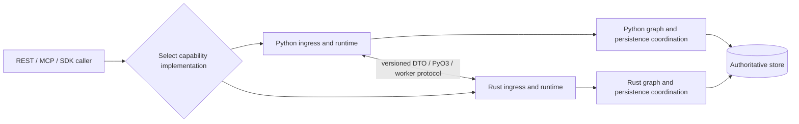
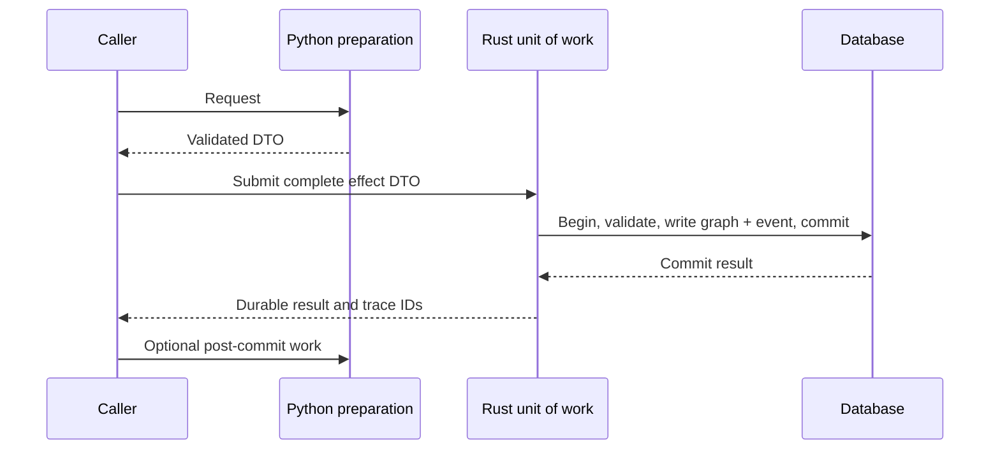
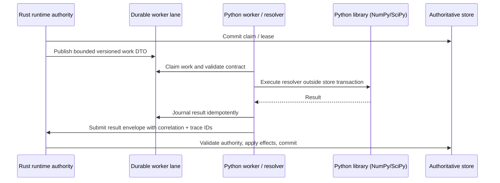

# ADR-022: Dual-Language Capability Paths

**Status:** Accepted as target architecture; implementation gates remain open
**Decision date:** 2026-10-24
**Scope:** Kogwistar core runtime, graph, storage, and service capabilities

## Context

ADR-015 describes an incremental Rust port, with Python retained as an SDK and
worker ecosystem and Rust eventually becoming the default implementation. That
is useful as a migration strategy but does not express the intended long-term
support policy: both Python and Rust implementations must remain usable. A
deployment may choose a Python implementation, a Rust implementation, or a
composition of the two at supported capability seams.

The mixed-workload benchmark already distinguishes Python authority, Python
with Rust authority, and a narrow Rust-native HTTP slice. Its results cannot
be extrapolated into a whole-stack performance ranking. The Rust server still
reports `runtime_cutover_ready: false` and `server_cutover_ready: false`, and its
pending-route list remains nonempty. A native Rust HTTP benchmark slice is not
evidence that every public operation has a native Rust execution path.

## Decision

Maintain Python and Rust as supported implementations of explicitly named
capabilities. Select an implementation per capability at a stable boundary,
before work enters that capability. A composed deployment may cross languages
through a versioned request/result contract, PyO3, or a worker protocol. No
crossing is implicit: its owner, conversion, failure, cancellation, trace, and
performance costs are part of the capability contract.

For latency-sensitive workloads, support an optional native end-to-end path in
either language when that path has complete capability coverage. Within such a
path, ingress, orchestration, graph operations, and persistence coordination
stay in the selected language for the measured request. Database, network,
provider, and client boundaries still exist; "native end-to-end" means no
Python/Rust handoff in the measured hot path. A native path is an optimization
choice, not a prerequisite for using either implementation.

Do not deprecate a Python or Rust capability merely because the other language
becomes faster or the default for one deployment. Deprecation of either public
implementation requires a separate architecture and compatibility decision.
This amends ADR-015's Phase 6 end-state and deletion policy. Its staged
migration, single-writer rule, parity gates, and downstream rollout discipline
still apply.

The diagram shows possible deployments, not simultaneous authority over the
same data. A native Python request follows `C -> P -> PG -> B`; a native Rust
request follows `C -> R -> RG -> B`. A mixed request uses one declared crossing
and retains the same authority and graph semantics. Selection is made for a
capability and execution context, not separately for every helper call.

## Implementation strategy

This is a capability-first program, not a file-by-file translation or a plan
to retire Python. The target is two independently usable implementations,
explicit mixed seams, and optional seam-free native paths for workloads that
have complete coverage. Work toward that target in this order:

1. **Finish an existing vertical capability.** Choose one `IN PROGRESS` gate
   in the companion checklist and name its exact operation, ingress surface,
   backend, principal, authority owner, and transaction boundary. Trace it
   from REST/MCP/SDK or workflow admission through graph/runtime effects to
   durable state and the returned result. Do not mark a backend or language
   combination supported because a lower-level unit test passes.
2. **Use current contracts and mechanisms first.** Reuse graph models,
   workflow events, the operation registry, store traits, versioned DTOs,
   existing selectors, and existing transaction owners. Add a trait, facade,
   adapter, or wire representation only after a concrete missing contract is
   demonstrated. Keep Python's public API and old wire defaults working.
3. **Make one authority decision before effects.** Freeze selection for the
   execution context; validate input, authentication, capability, scope, and
   backend support before admitting work. A Rust-selected operation must not
   silently execute through Python, and a Python-selected operation must not
   unexpectedly invoke Rust authority. One language owns every effect inside
   an atomic unit of work; a mixed path uses a declared, versioned crossing
   outside that unit or an owner-held opaque transaction command.
4. **Prove the whole vertical path.** Run the same valid and invalid fixtures
   through Python and Rust, then test real transport and storage: denied and
   cross-scope requests, event/projection/index-intent atomicity, retries,
   ambiguous acknowledgement, restart/reopen, trace identity, and concurrent
   claims where applicable. Run the required backend and interpreter matrix;
   report unsupported combinations explicitly. A test that only inspects a
   manifest or an in-process helper is not end-to-end evidence.
5. **Promote native paths only after parity.** For a claimed Rust-only path,
   prove the server binary and hot path do not load Python/PyO3 or call a
   Python worker, and measure actual seam crossings rather than trusting an
   attestation field alone. Apply the symmetric rule to a claimed Python-only
   path. Compare native Python, native Rust, and declared mixed paths with the
   same backend, resources, operation trace, and correctness digest before
   selecting an optimized default. Faster storage alone does not justify a
   whole-stack rewrite.

The practical dependency order is canonical persistence and graph effects,
then workflow/worker execution and recovery, then conversation/agent and the
remaining REST/MCP/CLI surfaces. PostgreSQL is the first complete graph and
transaction proving ground. SQLite remains a metadata/event/runtime backend
until a native graph authority is implemented and tested. The Rust service can
also compose SQLite metadata with Chroma node/edge projection reads; that does
not make SQLite a graph authority or establish graph-write parity. In the
PostgreSQL-to-Chroma projection design, Chroma is a derived projection, not a
substitute for canonical graph authority. An internal
pre-indexed route is a dependency, not proof that public ingestion, embeddings,
or all graph operations are native. A Python provider used by a Rust-owned
workflow makes that request mixed, not seam-free Rust.

At each slice boundary, update the existing checklist row with the exact
code/contract delta, tests and results, compatibility evidence, remaining
blockers, and whether the named capability is genuinely complete. Do not
reopen a `PASS` row without a demonstrated regression, invalid original
evidence, or approved contract change. Prefer closing existing rows; add a
linked row only for a genuinely new requirement. The original 130-item
baseline is fixed at commit `6130d04`: calculate baseline completion by
matching IDs against that commit, and report later-added scope separately.
Never infer baseline membership from an ID suffix or a recent evidence note.

### Execution guidance for future turns

The active goal may be paused. A documentation or review request does not
resume it or authorize unrelated implementation. Before editing, check the
goal, branch, worktree, current checklist, and relevant code. Preserve unrelated
changes. Select one existing open gate and state the exact behavior that will
be complete at the end of the slice. Use existing contracts and tests first;
avoid new abstractions, side quests, and checklist IDs unless an actual gap
requires a separately approved scope decision.

`DL-10` is closed for the bounded PostgreSQL inline native graph-effect path;
continue with the already-open `DL-07I` gaps rather than adding more DL-10
cases or reimplementing owner binding.
`NativeOperationRegistry::register_graph` lets a registered Rust operation
return a validated graph mutation batch without changing the public
`NativeOperationOutput` shape. The authenticated PostgreSQL HTTP result path
checks request capability/scope and durable run owner, then commits graph
events, projections, index intent, runtime result, and acknowledgement
together.

The current inline-worker implementation records a versioned
`runtime_owner_binding` in the server-generated `run.created` event for
authenticated run admission. A service trigger records a binding only when its
requested owner (from payload or target configuration) matches the authenticated
trigger actor; an ownerless legacy service run remains unbound. Before applying
an inline graph effect, the worker matches any binding to the durable run owner,
loads the current active user through the configured auth store, intersects
current namespace/capability authority with the run's admitted
scope/capability ceiling, and fails closed when it cannot establish authority.
A denial is persisted as a failed worker result rather than left to repeat as a
claimed graph write.
Relevant code is in `postgres_runtime_service.rs`,
`postgres_automation_service.rs`, and `application_services.rs`.

This is not yet proof of complete inline authorization or atomic revocation.
The auth identity store and PostgreSQL graph transaction are separate
authorities; capability state is process-local. The implementation rechecks
capability state during result application, but cannot serialize changes from
an independent policy store with the graph commit. Do not claim globally
linearizable revocation. For a service-triggered workflow, a supplied owner from
the trigger payload or target configuration must match the authenticated trigger
actor; otherwise admission returns `KOGWISTAR_RUN_OWNER_FORBIDDEN` before run or
lane creation. A legacy service run with no owner remains unowned and has no
inline graph-write authority. This is not a distinct service identity or
credential, and it does not authorize a trigger payload to select an arbitrary
owner.

The authenticated Python service-trigger API passes the authenticated user ID
(falling back to the authenticated subject) through the service layer. When a
request would admit a workflow, it rejects an owner from the trigger payload or
target configuration that differs from that actor before writing service
events. Busy, disabled, or suppressed triggers remain no-ops, matching Rust's
existing service-trigger ordering. Internal scheduler/message/graph triggers
that do not carry an authenticated API actor retain their existing behavior.
This aligns owner checks for workflow admission across the public Python and
Rust service-trigger paths; it does not make internal triggers a separately
authenticated principal or close the remaining inline-effect authorization
gaps.

The focused owner-revalidation and service-owner-binding unit tests pass. The
ignored PostgreSQL owner-revalidation test,
`postgres_inline_native_graph_effect_revalidates_current_owner`, was explicitly
run with `KOGWISTAR_TEST_PG_DSN` against a disposable pgvector container and
passed. It proves an authorized inline graph write persists and a subsequent
process-local `write_graph` revocation prevents the graph projection and records
a failed run. This test does not yet cover external auth-database changes or all
failure/recovery cases. The PostgreSQL service-trigger test also executes the
service's Rust-native graph operation end to end. It verifies the actor-matched
durable binding, graph event and projection persistence, successful run
completion, completed lane acknowledgement, and rejection of a mismatched
configured owner before lane creation. It now also admits a second service run,
changes the owner's active status, role, or namespace in the separate SQLite
auth database before native effect execution, and verifies for each case that
no graph event, projection, or index job is written, the run is durably failed,
and the lane is acknowledged. The successful service batch carries a
non-empty index intent and verifies its pending job alongside the graph event,
projection, succeeded run, and completed lane. The live inline-worker test also
submits an out-of-scope graph batch with an index intent; it verifies a durable
failed run and completed lane with no graph event, projection, or index job in
either namespace. The same live inline-worker test now tampers with the durable
`run.created` event by removing the owner binding or changing its user ID; in
both cases the run is durably failed, the lane is completed, and no graph event,
projection, or index job is written. The live test also installs a temporary
PostgreSQL trigger that rejects index-job insertion after graph mutations have
started; it proves the transaction leaves no graph event, projection, or index
job and does not acknowledge the lane. The same test then expires the durable
claim, reconstructs the application service, reclaims the run, and verifies one
graph event, projection, index job, succeeded run, and completed lane. The live
`postgres_authenticated_native_graph_operation_commits_and_replays` test
repeats the same native execution and verifies graph/index effects remain
singular. This closes the bounded DL-10 worker graph-effect transaction and
recovery gate. It does not establish whole-stack parity or globally atomic
revocation across the separate auth and graph stores.
Retain authenticated HTTP, legacy non-graph, and Python worker regressions. Keep
SQLite graph batches explicitly unsupported where no atomic graph authority
exists. If revocation cannot be atomic with graph commit, document and test its
actual consistency point. `DL-10` is complete for the bounded PostgreSQL inline
native graph-effect transaction and recovery path described above; this does
not claim whole-stack Rust/Python parity or globally atomic revocation across
the separate auth and graph stores.

Continue `DL-07I` from its recorded gaps rather than repeating completed
experiments. Existing evidence covers
lease fencing, stale Python Chroma/PostgreSQL deletes, Rust-native PostgreSQL
stale upsert/delete protection, and accepted-result recovery after projection
failure. The checklist still leaves transaction/recovery parity across runtime
and backend combinations open. Chroma follows ADR-018's `eventual_reconcile`
contract: stale in-flight writes are not transactionally fenced, so do not
claim PostgreSQL-style ordering or cross-store atomicity. A stale projection
must not be served as current, and reconciliation must be able to restore the
canonical revision after writes quiesce. This is not a requirement to add
backend-enforced multiwriter ordering. The separate ADR-015 restriction on
Python and Rust concurrently opening the same single-writer Chroma store
applies during shadow/canary migration; it does not redefine Chroma's general
consistency contract. Use `DL-07I`'s existing acceptance criteria and
evidence; do not add checklist rows for already-verified cases.

Legacy Chroma Stage-2 rows created before `_kogwistar_source_revision` was
introduced are intentionally hidden by the Rust read fence. An operator may
backfill this marker only while the normal projection writer is quiesced, using
`SQLiteChromaTwoStageProjectionAdapter.backfill_stage2_source_revisions()` or
its async counterpart in bounded pages. The adapter stamps a row only when its
stored source fingerprint matches the current active canonical revision; it
updates metadata only and leaves the stored document/vector unchanged. Rows
that are stale, deleted, malformed, or unverifiable stay hidden and must be
reprojected through the normal durable indexing path. This is an offline
compatibility migration, not a concurrent-writer protocol or a Chroma
transaction guarantee. Callers must advance the page offset by the returned
`fetched` count and complete the scan before resuming the projection writer.
Then advance an existing user-facing gate such as `DL-16BQ` only along a real
ingress-to-durable-result path; preserve explicit unsupported results where
the selected backend lacks authority.

At each slice, run the focused Rust tests and matching Python contract/parity
tests, plus live backend tests when the behavior depends on transactions or
concurrency. Include negative and positive cases, run the necessary interpreter
and CI matrix before claiming broad compatibility, and distinguish a skipped
test from a passing test. Reuse the workspace Cargo target directory unless an
isolation need is documented. Check test process exit and actual results; a
build or zero selected tests is not a pass. Update the existing checklist row
with current evidence and remaining blockers, keeping its denominator stable;
Git holds chronological details. Commit each tested slice with a substantive
message. If pushing is requested, watch the resulting GitHub CI runs and report
their actual outcomes.

## Transaction seam

Interchangeability applies at a **unit-of-work boundary**. It does not imply
that Python `sqlite3` and Rust `rusqlite`, or Python SQLAlchemy and Rust
`tokio-postgres`, can pass a live transaction to each other. Separate
PostgreSQL connections do not share one transaction just because they address
the same database. A connection or transaction object is not a portable DTO.
Python and Rust metadata bootstrap must nevertheless coordinate schema DDL
through the same stable transaction-scoped PostgreSQL advisory lock. This
prevents concurrent process startup from racing on compatible `CREATE TABLE`
operations; it is not a writer-ownership lock and does not prevent a process
with database credentials from opening an independent connection.
Graph projection records must also persist the engine-selected namespace in
their backend metadata in both implementations. Event-log namespace alone is
not enough when a physical projection collection is shared: the record scope
must remain checkable after a language handoff or reopen. A caller-provided
conflicting namespace is rejected rather than allowed to relabel the record.

When an operation needs graph, event, projection, ACL, and index-job effects
to commit atomically, one selected implementation owns the entire transaction
and performs all required writes through its own unit of work. The other
language may supply validated, side-effect-free input before that transaction
begins or consume its committed result afterward. A bounded transaction-owner
API may also accept commands during the transaction: the foreign facade holds
only an opaque transaction identity while the owner retains the actual
connection and applies every effect. The existing Python
`RustPostgresSession` uses this pattern to call Rust across PyO3 with a
transaction ID; its token rejects raw Python SQL. The foreign language may
not open its own connection and perform a required part of that atomic
operation. A provider call or unconstrained worker must not run inside the
owner's open transaction. If a capability cannot meet this rule, it is not
interchangeable at that seam yet; move the seam outward to encompass the whole
atomic operation or add a deliberately specified asynchronous/outbox workflow.
An outbox provides eventual follow-up, not a claim of cross-language or
cross-store ACID.

The Rust internal graph-mutation seam therefore treats indexing as an explicit
part of the command, not as an inferred side effect. A caller may attach
versioned index-job intents to a graph batch. PostgreSQL commits the graph
event, projection, and queue intents in one native unit of work; stores without
that capability reject the combined request. Omitting the intents retains the
legacy pre-indexed contract and does not claim that embedding or indexing was
performed.

For graph/vector data held outside the canonical SQL store, the additive Rust
`projection_worker::run_graph_projection_jobs_once` composes an
`IndexJobWriteStore` with any `GraphWriteStore`. A PostgreSQL queue can
therefore drive a Chroma graph projection without pretending that Chroma joins
the PostgreSQL transaction. The worker durably admits a versioned projection
action before applying it, reuses that action after a projection failure, and
acknowledges the queue only after the upsert/delete succeeds. The PostgreSQL
queue remains the authority; the Chroma records are a derived projection.
The accepted action is a versioned JSON wire contract shared through
`contracts/golden/graph-projection-action-v1.json`: Rust produces and consumes
it, while Python's strict decoder verifies the exact persisted-byte digest and
queue binding before interpreting the action. The sync and async Python index
workers accept an optional graph-projection adapter for this action family;
without that adapter, they retry/fail the job rather than acknowledging an
unapplied action. Existing accepted embedding-result behavior remains
unchanged. JSON object key order is not a semantic requirement; the digest
always covers the original serialized bytes. Python adapters must raise on
write errors; an explicit `False` from upsert is treated as rejection and is
retried rather than acknowledged. A delete that reports `False` (already
absent) is accepted as the same idempotent desired state as the Rust store.
Accepted queue values must remain strings, matching the Rust DTO contract;
non-string adapter values fail/retry. The generic result-admission worker
preserves legacy opaque-string replay semantics, including malformed or
non-object JSON strings. Projection actions are recognized only by their
versioned object markers and then validated against the strict action schema.

The Rust PostgreSQL service uses this worker for its opt-in inline embedding
worker, with PostgreSQL as both queue and graph store. Rust server selection
also supports SQLite metadata with Chroma graph reads, but does not wire this
worker to a Chroma projection destination. Its generic contract does not fence
an older in-flight projection against a newer
write from another worker for the same entity. This is an explicit limitation,
not a requirement to reproduce PostgreSQL transactions in Chroma: overlapping
writers may temporarily leave a stale physical projection, and only the
canonical revision may be served. The eventual-repair contract requires
reconciliation to restore the canonical projection after writes quiesce; it
does not promise ordering or atomicity while distinct revisions race. During
Python/Rust shadow or canary migration, retain ADR-015's single-writer
operational restriction. Replaying the same accepted action is idempotent, but
idempotency alone does not establish ordering between distinct revisions.

| Backend | Current boundary | Required handoff |
| --- | --- | --- |
| SQLite | Existing context binding prohibits overlapping Python/Rust handles on one database in one process. | Finish commit or rollback, close connections and cached sessions, release ownership, then reopen under the other implementation. Do not switch within an active execution context. |
| PostgreSQL | Rust store has a native unit of work; `KOGWISTAR_IMPL_POSTGRES_AUTHORITY=rust` requires both graph and metadata selectors to be Rust so those writes can share it. | A Python facade may submit bounded commands with an opaque transaction ID while Rust retains the connection. Complete the owning transaction before an authority change. A separate SQLAlchemy connection cannot join the Rust transaction. Prove visibility and schema compatibility on reopen. |
| Multiple stores | Existing architecture does not promise cross-store atomicity. | Use the documented event/outbox or two-stage persistence contract and idempotent recovery; never report a partial multi-store effect as one atomic commit. |

This is one possible mixed path. The same rule holds with Python as the unit
of work owner and Rust supplying pure computation outside the transaction.

## Rust scheduler with Python step implementations

The reverse direction is a supported composition pattern, not an implicit
callback from arbitrary Rust code. Kogwistar already has a Python facade that
selects the Rust durable runtime authority and a `RustRuntimeWorker` /
`AsyncRustRuntimeWorker` that claims committed work, resolves the frozen
workflow `op` to a Python step, then submits a restricted JSON result envelope.
See `runtime/rust_runtime_authority.py`, `runtime/rust_worker.py`, and
`docs/ADR-015-runtime-semantics-contract.md`. The Rust scheduler commits the
claim before Python executes; the Python callback runs outside the Rust store
transaction; Rust validates and persists the result in a later transaction.
The worker journal fails closed when a callback may have run but its result was
not durably journaled.

For the v1 worker-result envelope, Python emits the known optional `transition`
field explicitly as `null`, matching the Rust Serde canonical serialization.
Rust continues accepting the field's omission as `None` so older worker payloads
remain compatible. Shared golden fixtures exercise both forms; optional-field
omission must be deliberate and tested rather than an accidental serializer
difference.

This does not mean every standalone Rust HTTP server can currently load or
dispatch arbitrary Python resolvers. Server/runtime cutover status remains
incomplete. The implemented worker path is a separately hosted Python worker
using Kogwistar's protocol and restrictions. If a step needs NumPy, SciPy, or
another Python-only library, it belongs in that Python worker; send it a
bounded, versioned JSON DTO or an explicit artifact reference, then validate
the JSON result in Rust. Inject library clients and other live Python objects
through the worker's process-local dependency provider, not through the durable
workflow state or wire DTO. `_deps` is removed before state comparison and
effect serialization; it must never be persisted or accepted as worker output.
Do not serialize native arrays as huge JSON lists by default: define size limits
and use a content-addressed/shared artifact or an explicit binary transport
when payloads warrant it.

The local seam POC also exercises a synchronous Rust-to-Python callback over a
persistent JSONL process for a bounded NumPy calculation. It validates
contract/correlation and demonstrates the round trip only; it is not the
production Kogwistar worker protocol, and it deliberately holds no database
transaction across the callback. Evidence and limitations are in the root
`doc/dual_language_seam_poc.md`.

Workflow nodes also have `wf_version` for replay compatibility. The Rust
worker plan freezes this per-node version through run state and worker claims,
separately from the worker transport protocol. `MappingStepResolver.register`
can declare a handler version; mismatches fail before callback execution, and
resume compares the saved operation-version map with the current workflow.
Absent versions remain `v1`, and default `v1` fields are omitted from the wire
to preserve legacy payload shape. The legacy `MappingStepResolver.register()`
and `AsyncMappingStepResolver.register()` APIs retain one active version per
operation. The additive `register_versioned()` API can retain historical
implementations alongside the active one, and Rust-owned Python workers plus
the native Python sync/async runtimes resolve by the workflow node's frozen
`wf_version`. A resumed run therefore fails closed if its exact version is not
registered rather than silently invoking the active implementation. Engine-
backed workflow admission checks resolver version support before the run
starts; legacy callable resolvers remain valid for default `v1` workflows but
cannot claim support for a non-default version without a version-aware lookup
contract. Do not treat the worker protocol's `sync-v1` or `async-v2` label as
the version of a particular registered operation.

`wf_version` identifies the operation contract, not the complete executable
environment. Nodes may additionally declare `wf_environment_id`; the typed
workflow metadata validates its canonical form, and Python sync/async workflow
admission requires it to match the resolver's `environment_id` for that exact
operation version before the run starts. The Rust-owned Python worker path
freezes the same requirement into each claim and a mismatching worker rejects
the claim before callback execution. Omitting the field preserves legacy
workflow behavior. The Rust lane claim is recipient-filtered: generic workers
continue to claim `python-worker` messages, while workers built from a resolver
with environment-pinned operations additionally claim deterministic
`python-worker-env-<base64url(sha256(environment_id))>` recipients. The
worker requests compatible environment recipients before the generic recipient,
and the server preserves that order when consuming a claim limit, so a worker
does not spend its single-item poll on generic work while its specialized queue
is ready. The environment ID must be canonical (non-empty and without
surrounding whitespace), so Python registration, workflow metadata, and claim
routing do not silently normalize to different identities. This is an explicit
compatibility label, not proof of the installed Python, NumPy, SciPy, native
BLAS, or other dependency build. The current implementation does not verify an
immutable image/lockfile digest or record that attested identity in traces.
Those remain rollout gates for heterogeneous worker pools.

For a Python step that needs a process-local numerical service, the supported
production composition is the existing claimed-worker path: Rust commits the
claim, the Python worker resolves the frozen `op` through its configured step
resolver and receives the service through `dependency_provider`, then Rust
validates and commits the JSON effect. This is a queued workflow capability,
not a synchronous arbitrary callback from each Rust HTTP handler. A handler
that needs a synchronous Python computation must explicitly define a separate
RPC capability with its own deadline, payload limit, cancellation, and retry
contract rather than silently invoking Python on the request hot path.

## Capability contract

Each selectable capability must publish:

- an operation and schema version, supported backend and interpreter/platform
  matrix, and explicit Python/Rust implementation coverage;
- the authority owner, transaction/commit boundary, consistency and retry
  semantics, idempotency keys, and recovery behavior;
- normalized input, output, error code, canonical identifiers, source-span,
  ACL/scope, provenance, and trace fields;
- permitted seams (in-process PyO3, local/remote worker, RPC, or no language
  crossing), including serialization format and size limits;
- a measurable native-path declaration for each workload that claims one;
- conformance fixtures for valid and invalid inputs and durable effects.

The current crosswalk is `contracts/dual-language-capabilities-v1.json`. It
reconciles the frozen ADR-015 capability ownership entries and Rust's pending
REST/syscall inventory, while marking native paths and unverified mixed paths
explicitly. It is an inventory aid, not a second cutover authority: tests bind
its copied identifiers and gap lists to their source declarations. The
crosswalk remains `inventory-in-progress` until every public graph, storage,
runtime, conversation, agent, REST, MCP, and CLI operation has an evidenced
implementation and conformance status.

Pydantic and Serde models may be different internal representations. The
versioned boundary schema and canonical persisted format are shared. A public
Python API may use Rust authority without becoming a native Python path; a
Python-only application path may use a Rust native extension without becoming
a native Rust path. Deployment labels must reflect the actual request path.

## Invariants

1. **Single authority.** For each resource and capability, exactly one selected
   implementation owns authoritative writes at a time. Read-only shadowing is
   allowed, with no second writer or silent fallback after a partial effect.
2. **Stable semantics.** Python, Rust, and mixed paths preserve the same graph
   IDs, node/edge/hyperedge meaning, source grounding, ACL and namespace
   checks, workflow transitions, provenance, and durable trace relationships.
3. **Canonical persistence.** A committed event, source map, checkpoint, or
   projection has one versioned on-disk/wire meaning. Either supported
   implementation can reopen and validate it where its capability matrix
   declares support. Schema migration and rollback rules are explicit.
4. **Boundary validation.** Every language crossing validates a versioned
   request/result envelope. The receiving host rechecks authorization and
   scope before effects; a DTO, worker result, or tool declaration cannot grant
   authority. Unknown or lossy required fields fail closed. The shared strict
   JSON conversion rejects non-finite numeric values, non-string object keys,
   and integers outside Rust Serde JSON's signed-64/unsigned-64 range before
   journaling, transport, or any PyO3 JSON ABI call, rather than relying on
   one runtime's coercive or non-standard JSON behavior. Validation must happen
   before invoking the receiving implementation. Worker message, run, step,
   claimant, and correlation identities are also mandatory and validated before
   a Python callback, including callbacks that may perform external effects.
   Existing tuple-to-array conversion remains compatible.
5. **Commit and retry safety.** Commit acknowledgement, effect identity, lease,
   cancellation, replay, and ambiguous side effects retain their documented
   meaning across Python, Rust, and mixed paths. No retry duplicates a
   non-idempotent effect. A terminal commit/rollback attempt also releases its
   local transaction token, worker handle, and session-registry ownership on
   success and failure; an uncertain commit result is never blindly replayed.
   A worker callback receives the stable lane idempotency key in its execution
   context so external effects can deduplicate across lease reclaim; the key is
   advisory to the external service and does not create exactly-once delivery.
6. **Trace continuity.** One request retains run, step, event, principal,
   capability, and parent-span identity across seams. Transport sequence
   numbers are not confused with durable event sequences.
7. **Execution-context ownership.** Selection remains fixed for an active
   capability execution. In particular, Python and Rust SQLite handles do not
   overlap on one database in one process; handoff closes/releases ownership
   according to the existing SQLite interop contract. Participating Python and
   Rust entrypoints also use cooperative cross-process authority locks for the
   database path and file identity: POSIX file locks and Windows named mutexes.
   Existing tests cover bounded startup, contention, crash, and handoff cases;
   see the open `DL-07E` gate for remaining platform and entrypoint coverage.
   These locks do not govern non-participating SQLite clients or guarantee
   behavior on every filesystem or Windows session. Deployments must establish
   equivalent ownership for clients outside this protocol.
8. **No hidden crossing in native mode.** A path advertised as native records
   every participating component. It cannot invoke the other language in the
   measured hot path, including callbacks, provider adapters, or persistence
   helpers. If it does, advertise and measure it as a mixed path.
9. **Independent support.** Tests and releases continue to exercise both
   implementations for their declared capabilities. Neither is treated as a
   temporary fallback solely because the other reaches parity or wins a
   benchmark.
10. **Evidence-based optimization.** Native paths are selected for performance
    only from representative, resource-matched end-to-end measurements that
    include startup, steady state, p50/p95/p99 latency, throughput, CPU, memory,
    database effects, and seam costs. A narrow vertical slice proves only its
    measured operations.
11. **Transaction closure at a seam.** One language owns an atomic unit of
    work from begin through commit or rollback. A cross-language call may
    carry an opaque owner-scoped transaction ID for bounded native commands;
    it never transfers a live connection or grants a second writer. An
    authority change occurs after the previous unit of work and connection
    ownership are released.
12. **Runtime dependencies are not wire state.** Python worker dependencies
    such as NumPy/SciPy services, engines, and clients are injected locally and
    never serialized into durable state or returned effects. Only the explicit
    versioned JSON request/result contract crosses to Rust.
13. **Runtime dependencies are run-scoped.** A worker resolves live Python
    dependencies by the claimed durable `run_id`, never through a process-wide
    "current dependencies" slot. Missing registrations fail closed; a
    suspended run retains its dependencies for resume, and terminal runs
    release them. Concurrent runs cannot receive one another's services.
14. **Worker implementation compatibility is explicit.** An operation version
    does not stand in for its runtime/dependency environment. Where behavior
    depends on Python or native-library versions, work declares a compatible
    environment and a mismatching worker must not execute it. Production
    heterogeneous pools must route to compatible workers and trace an
    independently verifiable worker build identity; the current label check
    alone is insufficient evidence of the installed environment.

### Boundary field slicing

Pydantic-extension remains authoritative for Python model annotations and
dynamic slices. It must not be silently replaced by a Rust serializer that
guesses from field names. A Python model may export its resolved field policy
through the versioned `GraphSliceManifestV1` contract. The manifest records the
allowed modes (`backend`, `frontend`, `dto`, `llm`, and `llm_in`) for each field
and recursively describes nested models.

Rust applies that manifest with `GraphModelEnvelope::project_slice()`. The
canonical backend payload remains lossless; unlisted legacy fields are retained
only for the backend mode. Public and LLM projections are deny-by-default, so
an omitted rule cannot accidentally expose an ACL field, source-map locator,
embedding, or verification record. Slice mode, manifest version, and model
class are part of the projection contract and should be included in cache and
trace keys.

This is a boundary contract, not an authorization mechanism. ACL, namespace,
source-evidence, and capability checks remain authoritative after projection.
Custom model families are not considered slice-compatible until their manifest
has been exported and differential-tested against Python's
`model_dump(field_mode=...)` output.

## Verification and rollout

Run one shared operation trace and golden corpus through each declared path.
Compare results, errors, event history, durable state digests, ACL decisions,
traces, and recovery after restart. Include sequential handoff, concurrent
readers/writers, stale requests, injected failure around commit, and mixed
version/schema reopen. An unsupported combination is reported explicitly; it
must not silently route to another implementation.

For each mixed path, inject a failure before commit, during the other language's
preparation, after commit but before acknowledgement, and during post-commit
work. Verify no graph/event split write, duplicate retry, false atomicity, or
stale read. Include PostgreSQL graph-plus-metadata operations and SQLite
connection close/reopen handoff in the shared corpus.

Benchmark pure Python, mixed paths, and pure Rust under equivalent CPU, RAM,
backend, dataset, and transport conditions. Record warm-up separately and
attribute serialization, PyO3, worker, and store time where observable. Do not
infer a full-stack speedup from `mixed_rewrite_benchmark.md`'s narrow Rust
HTTP slice or from a storage-only microbenchmark.

The Python and Rust support matrices can grow independently. A deployment may
select a capability only when that implementation's conformance gates pass.
Native end-to-end operation is claimed per workload and surface, not as a
global boolean for an incomplete server or runtime. ADR-015 canary controls
remain applicable when an adopter changes the authoritative writer.

## Consequences and open decisions

Two supported implementations require recurring parity, security, packaging,
and consumer CI. Native paths may duplicate orchestration code. A shared
contract reduces semantic drift but does not remove this maintenance cost.

Before implementing a new seam, decide its capability granularity, schema
versioning and compatibility window, connection/transaction ownership, worker
failure policy, and whether the target workload benefits from a native path.
Before advertising a native Rust path, close or explicitly exclude pending
runtime and server operations. Before advertising a native Python path, verify
the selected workload has no required Rust extension or worker hop.

Track these decisions and executable gates in
`ADR-022-dual-language-capability-checklist.md`.

The standalone feasibility experiment is recorded in the repository-root
`doc/dual_language_seam_poc.md`; its source is under
`experiments/dual_language_seam_poc/`. It validates the contract/transaction
pattern at toy scale only and does not close Kogwistar implementation gates.
