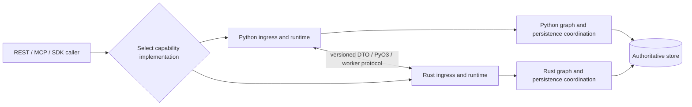
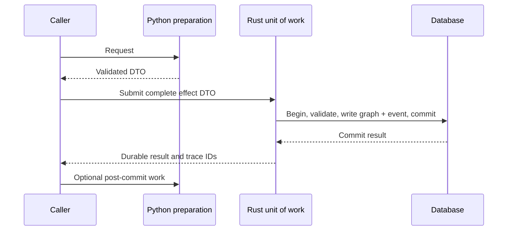
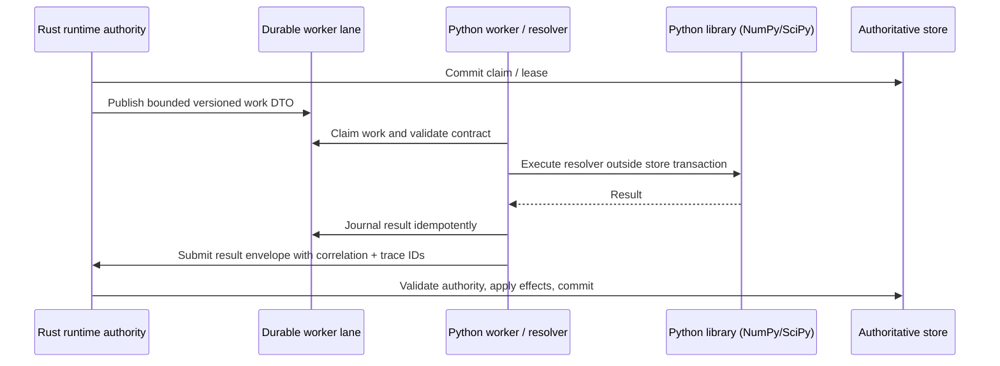

# ADR-022: Dual-Language Capability Paths

**Status:** Accepted as target architecture; implementation gates remain open
**Decision date:** 2026-10-24
**Scope:** Kogwistar core runtime, graph, storage, and service capabilities

## Context

ADR-015 describes an incremental Rust port, with Python retained as an SDK and
worker ecosystem and Rust eventually becoming the default implementation. That
is useful as a migration strategy but does not express the intended long-term
support policy: both Python and Rust implementations must remain usable. A
deployment may choose a Python implementation, a Rust implementation, or a
composition of the two at supported capability seams.

The mixed-workload benchmark already distinguishes Python authority, Python
with Rust authority, and a narrow Rust-native HTTP slice. Its results cannot
be extrapolated into a whole-stack performance ranking. The Rust server still
reports `runtime_cutover_ready: false` and `server_cutover_ready: false`, and its
pending-route list remains nonempty. A native Rust HTTP benchmark slice is not
evidence that every public operation has a native Rust execution path.

## Decision

Maintain Python and Rust as supported implementations of explicitly named
capabilities. Select an implementation per capability at a stable boundary,
before work enters that capability. A composed deployment may cross languages
through a versioned request/result contract, PyO3, or a worker protocol. No
crossing is implicit: its owner, conversion, failure, cancellation, trace, and
performance costs are part of the capability contract.

For latency-sensitive workloads, support an optional native end-to-end path in
either language when that path has complete capability coverage. Within such a
path, ingress, orchestration, graph operations, and persistence coordination
stay in the selected language for the measured request. Database, network,
provider, and client boundaries still exist; "native end-to-end" means no
Python/Rust handoff in the measured hot path. A native path is an optimization
choice, not a prerequisite for using either implementation.

Do not deprecate a Python or Rust capability merely because the other language
becomes faster or the default for one deployment. Deprecation of either public
implementation requires a separate architecture and compatibility decision.
This amends ADR-015's Phase 6 end-state and deletion policy. Its staged
migration, single-writer rule, parity gates, and downstream rollout discipline
still apply.

The diagram shows possible deployments, not simultaneous authority over the
same data. A native Python request follows `C -> P -> PG -> B`; a native Rust
request follows `C -> R -> RG -> B`. A mixed request uses one declared crossing
and retains the same authority and graph semantics. Selection is made for a
capability and execution context, not separately for every helper call.

## Transaction seam

Interchangeability applies at a **unit-of-work boundary**. It does not imply
that Python `sqlite3` and Rust `rusqlite`, or Python SQLAlchemy and Rust
`tokio-postgres`, can pass a live transaction to each other. Separate
PostgreSQL connections do not share one transaction just because they address
the same database. A connection or transaction object is not a portable DTO.

When an operation needs graph, event, projection, ACL, and index-job effects
to commit atomically, one selected implementation owns the entire transaction
and performs all required writes through its own unit of work. The other
language may supply validated, side-effect-free input before that transaction
begins or consume its committed result afterward. A bounded transaction-owner
API may also accept commands during the transaction: the foreign facade holds
only an opaque transaction identity while the owner retains the actual
connection and applies every effect. The existing Python
`RustPostgresSession` uses this pattern to call Rust across PyO3 with a
transaction ID; its token rejects raw Python SQL. The foreign language may
not open its own connection and perform a required part of that atomic
operation. A provider call or unconstrained worker must not run inside the
owner's open transaction. If a capability cannot meet this rule, it is not
interchangeable at that seam yet; move the seam outward to encompass the whole
atomic operation or add a deliberately specified asynchronous/outbox workflow.
An outbox provides eventual follow-up, not a claim of cross-language or
cross-store ACID.

The Rust internal graph-mutation seam therefore treats indexing as an explicit
part of the command, not as an inferred side effect. A caller may attach
versioned index-job intents to a graph batch. PostgreSQL commits the graph
event, projection, and queue intents in one native unit of work; stores without
that capability reject the combined request. Omitting the intents retains the
legacy pre-indexed contract and does not claim that embedding or indexing was
performed.

| Backend | Current boundary | Required handoff |
| --- | --- | --- |
| SQLite | Existing context binding prohibits overlapping Python/Rust handles on one database in one process. | Finish commit or rollback, close connections and cached sessions, release ownership, then reopen under the other implementation. Do not switch within an active execution context. |
| PostgreSQL | Rust store has a native unit of work; `KOGWISTAR_IMPL_POSTGRES_AUTHORITY=rust` requires both graph and metadata selectors to be Rust so those writes can share it. | A Python facade may submit bounded commands with an opaque transaction ID while Rust retains the connection. Complete the owning transaction before an authority change. A separate SQLAlchemy connection cannot join the Rust transaction. Prove visibility and schema compatibility on reopen. |
| Multiple stores | Existing architecture does not promise cross-store atomicity. | Use the documented event/outbox or two-stage persistence contract and idempotent recovery; never report a partial multi-store effect as one atomic commit. |

This is one possible mixed path. The same rule holds with Python as the unit
of work owner and Rust supplying pure computation outside the transaction.

## Rust scheduler with Python step implementations

The reverse direction is a supported composition pattern, not an implicit
callback from arbitrary Rust code. Kogwistar already has a Python facade that
selects the Rust durable runtime authority and a `RustRuntimeWorker` /
`AsyncRustRuntimeWorker` that claims committed work, resolves the frozen
workflow `op` to a Python step, then submits a restricted JSON result envelope.
See `runtime/rust_runtime_authority.py`, `runtime/rust_worker.py`, and
`docs/ADR-015-runtime-semantics-contract.md`. The Rust scheduler commits the
claim before Python executes; the Python callback runs outside the Rust store
transaction; Rust validates and persists the result in a later transaction.
The worker journal fails closed when a callback may have run but its result was
not durably journaled.

For the v1 worker-result envelope, Python emits the known optional `transition`
field explicitly as `null`, matching the Rust Serde canonical serialization.
Rust continues accepting the field's omission as `None` so older worker payloads
remain compatible. Shared golden fixtures exercise both forms; optional-field
omission must be deliberate and tested rather than an accidental serializer
difference.

This does not mean every standalone Rust HTTP server can currently load or
dispatch arbitrary Python resolvers. Server/runtime cutover status remains
incomplete. The implemented worker path is a separately hosted Python worker
using Kogwistar's protocol and restrictions. If a step needs NumPy, SciPy, or
another Python-only library, it belongs in that Python worker; send it a
bounded, versioned JSON DTO or an explicit artifact reference, then validate
the JSON result in Rust. Inject library clients and other live Python objects
through the worker's process-local dependency provider, not through the durable
workflow state or wire DTO. `_deps` is removed before state comparison and
effect serialization; it must never be persisted or accepted as worker output.
Do not serialize native arrays as huge JSON lists by default: define size limits
and use a content-addressed/shared artifact or an explicit binary transport
when payloads warrant it.

The local seam POC also exercises a synchronous Rust-to-Python callback over a
persistent JSONL process for a bounded NumPy calculation. It validates
contract/correlation and demonstrates the round trip only; it is not the
production Kogwistar worker protocol, and it deliberately holds no database
transaction across the callback. Evidence and limitations are in the root
`doc/dual_language_seam_poc.md`.

Workflow nodes also have `wf_version` for replay compatibility. The Rust
worker plan freezes this per-node version through run state and worker claims,
separately from the worker transport protocol. `MappingStepResolver.register`
can declare a handler version; mismatches fail before callback execution, and
resume compares the saved operation-version map with the current workflow.
Absent versions remain `v1`, and default `v1` fields are omitted from the wire
to preserve legacy payload shape. The legacy `MappingStepResolver.register()`
and `AsyncMappingStepResolver.register()` APIs retain one active version per
operation. The additive `register_versioned()` API can retain historical
implementations alongside the active one, and Rust-owned Python workers plus
the native Python sync/async runtimes resolve by the workflow node's frozen
`wf_version`. A resumed run therefore fails closed if its exact version is not
registered rather than silently invoking the active implementation. Engine-
backed workflow admission checks resolver version support before the run
starts; legacy callable resolvers remain valid for default `v1` workflows but
cannot claim support for a non-default version without a version-aware lookup
contract. Do not treat the worker protocol's `sync-v1` or `async-v2` label as
the version of a particular registered operation.

`wf_version` identifies the operation contract, not the complete executable
environment. Nodes may additionally declare `wf_environment_id`; the typed
workflow metadata validates its canonical form, and Python sync/async workflow
admission requires it to match the resolver's `environment_id` for that exact
operation version before the run starts. The Rust-owned Python worker path
freezes the same requirement into each claim and a mismatching worker rejects
the claim before callback execution. Omitting the field preserves legacy
workflow behavior. The Rust lane claim is recipient-filtered: generic workers
continue to claim `python-worker` messages, while workers built from a resolver
with environment-pinned operations additionally claim deterministic
`python-worker-env-<base64url(sha256(environment_id))>` recipients. The
worker requests compatible environment recipients before the generic recipient,
and the server preserves that order when consuming a claim limit, so a worker
does not spend its single-item poll on generic work while its specialized queue
is ready. The environment ID must be canonical (non-empty and without
surrounding whitespace), so Python registration, workflow metadata, and claim
routing do not silently normalize to different identities. This is an explicit
compatibility label, not proof of the installed Python, NumPy, SciPy, native
BLAS, or other dependency build. The current implementation does not verify an
immutable image/lockfile digest or record that attested identity in traces.
Those remain rollout gates for heterogeneous worker pools.

For a Python step that needs a process-local numerical service, the supported
production composition is the existing claimed-worker path: Rust commits the
claim, the Python worker resolves the frozen `op` through its configured step
resolver and receives the service through `dependency_provider`, then Rust
validates and commits the JSON effect. This is a queued workflow capability,
not a synchronous arbitrary callback from each Rust HTTP handler. A handler
that needs a synchronous Python computation must explicitly define a separate
RPC capability with its own deadline, payload limit, cancellation, and retry
contract rather than silently invoking Python on the request hot path.

## Capability contract

Each selectable capability must publish:

- an operation and schema version, supported backend and interpreter/platform
  matrix, and explicit Python/Rust implementation coverage;
- the authority owner, transaction/commit boundary, consistency and retry
  semantics, idempotency keys, and recovery behavior;
- normalized input, output, error code, canonical identifiers, source-span,
  ACL/scope, provenance, and trace fields;
- permitted seams (in-process PyO3, local/remote worker, RPC, or no language
  crossing), including serialization format and size limits;
- a measurable native-path declaration for each workload that claims one;
- conformance fixtures for valid and invalid inputs and durable effects.

The current crosswalk is `contracts/dual-language-capabilities-v1.json`. It
reconciles the frozen ADR-015 capability ownership entries and Rust's pending
REST/syscall inventory, while marking native paths and unverified mixed paths
explicitly. It is an inventory aid, not a second cutover authority: tests bind
its copied identifiers and gap lists to their source declarations. The
crosswalk remains `inventory-in-progress` until every public graph, storage,
runtime, conversation, agent, REST, MCP, and CLI operation has an evidenced
implementation and conformance status.

Pydantic and Serde models may be different internal representations. The
versioned boundary schema and canonical persisted format are shared. A public
Python API may use Rust authority without becoming a native Python path; a
Python-only application path may use a Rust native extension without becoming
a native Rust path. Deployment labels must reflect the actual request path.

## Invariants

1. **Single authority.** For each resource and capability, exactly one selected
   implementation owns authoritative writes at a time. Read-only shadowing is
   allowed, with no second writer or silent fallback after a partial effect.
2. **Stable semantics.** Python, Rust, and mixed paths preserve the same graph
   IDs, node/edge/hyperedge meaning, source grounding, ACL and namespace
   checks, workflow transitions, provenance, and durable trace relationships.
3. **Canonical persistence.** A committed event, source map, checkpoint, or
   projection has one versioned on-disk/wire meaning. Either supported
   implementation can reopen and validate it where its capability matrix
   declares support. Schema migration and rollback rules are explicit.
4. **Boundary validation.** Every language crossing validates a versioned
   request/result envelope. The receiving host rechecks authorization and
   scope before effects; a DTO, worker result, or tool declaration cannot grant
   authority. Unknown or lossy required fields fail closed. The shared strict
   JSON conversion rejects non-finite numeric values, non-string object keys,
   and integers outside Rust Serde JSON's signed-64/unsigned-64 range before
   journaling, transport, or any PyO3 JSON ABI call, rather than relying on
   one runtime's coercive or non-standard JSON behavior. Validation must happen
   before invoking the receiving implementation. Worker message, run, step,
   claimant, and correlation identities are also mandatory and validated before
   a Python callback, including callbacks that may perform external effects.
   Existing tuple-to-array conversion remains compatible.
5. **Commit and retry safety.** Commit acknowledgement, effect identity, lease,
   cancellation, replay, and ambiguous side effects retain their documented
   meaning across Python, Rust, and mixed paths. No retry duplicates a
   non-idempotent effect. A terminal commit/rollback attempt also releases its
   local transaction token, worker handle, and session-registry ownership on
   success and failure; an uncertain commit result is never blindly replayed.
   A worker callback receives the stable lane idempotency key in its execution
   context so external effects can deduplicate across lease reclaim; the key is
   advisory to the external service and does not create exactly-once delivery.
6. **Trace continuity.** One request retains run, step, event, principal,
   capability, and parent-span identity across seams. Transport sequence
   numbers are not confused with durable event sequences.
7. **Execution-context ownership.** Selection remains fixed for an active
   capability execution. In particular, Python and Rust SQLite handles do not
   overlap on one database in one process; handoff closes/releases ownership
   according to the existing SQLite interop contract. The current guard is
   process-local, not a cross-process lock. Deployments sharing one SQLite file
   across processes must select one language authority for that file or add an
   external ownership mechanism; cross-process mixed-language handoff is not
   currently guaranteed.
8. **No hidden crossing in native mode.** A path advertised as native records
   every participating component. It cannot invoke the other language in the
   measured hot path, including callbacks, provider adapters, or persistence
   helpers. If it does, advertise and measure it as a mixed path.
9. **Independent support.** Tests and releases continue to exercise both
   implementations for their declared capabilities. Neither is treated as a
   temporary fallback solely because the other reaches parity or wins a
   benchmark.
10. **Evidence-based optimization.** Native paths are selected for performance
    only from representative, resource-matched end-to-end measurements that
    include startup, steady state, p50/p95/p99 latency, throughput, CPU, memory,
    database effects, and seam costs. A narrow vertical slice proves only its
    measured operations.
11. **Transaction closure at a seam.** One language owns an atomic unit of
    work from begin through commit or rollback. A cross-language call may
    carry an opaque owner-scoped transaction ID for bounded native commands;
    it never transfers a live connection or grants a second writer. An
    authority change occurs after the previous unit of work and connection
    ownership are released.
12. **Runtime dependencies are not wire state.** Python worker dependencies
    such as NumPy/SciPy services, engines, and clients are injected locally and
    never serialized into durable state or returned effects. Only the explicit
    versioned JSON request/result contract crosses to Rust.
13. **Runtime dependencies are run-scoped.** A worker resolves live Python
    dependencies by the claimed durable `run_id`, never through a process-wide
    "current dependencies" slot. Missing registrations fail closed; a
    suspended run retains its dependencies for resume, and terminal runs
    release them. Concurrent runs cannot receive one another's services.
14. **Worker implementation compatibility is explicit.** An operation version
    does not stand in for its runtime/dependency environment. Where behavior
    depends on Python or native-library versions, work declares a compatible
    environment and a mismatching worker must not execute it. Production
    heterogeneous pools must route to compatible workers and trace an
    independently verifiable worker build identity; the current label check
    alone is insufficient evidence of the installed environment.

### Boundary field slicing

Pydantic-extension remains authoritative for Python model annotations and
dynamic slices. It must not be silently replaced by a Rust serializer that
guesses from field names. A Python model may export its resolved field policy
through the versioned `GraphSliceManifestV1` contract. The manifest records the
allowed modes (`backend`, `frontend`, `dto`, `llm`, and `llm_in`) for each field
and recursively describes nested models.

Rust applies that manifest with `GraphModelEnvelope::project_slice()`. The
canonical backend payload remains lossless; unlisted legacy fields are retained
only for the backend mode. Public and LLM projections are deny-by-default, so
an omitted rule cannot accidentally expose an ACL field, source-map locator,
embedding, or verification record. Slice mode, manifest version, and model
class are part of the projection contract and should be included in cache and
trace keys.

This is a boundary contract, not an authorization mechanism. ACL, namespace,
source-evidence, and capability checks remain authoritative after projection.
Custom model families are not considered slice-compatible until their manifest
has been exported and differential-tested against Python's
`model_dump(field_mode=...)` output.

## Verification and rollout

Run one shared operation trace and golden corpus through each declared path.
Compare results, errors, event history, durable state digests, ACL decisions,
traces, and recovery after restart. Include sequential handoff, concurrent
readers/writers, stale requests, injected failure around commit, and mixed
version/schema reopen. An unsupported combination is reported explicitly; it
must not silently route to another implementation.

For each mixed path, inject a failure before commit, during the other language's
preparation, after commit but before acknowledgement, and during post-commit
work. Verify no graph/event split write, duplicate retry, false atomicity, or
stale read. Include PostgreSQL graph-plus-metadata operations and SQLite
connection close/reopen handoff in the shared corpus.

Benchmark pure Python, mixed paths, and pure Rust under equivalent CPU, RAM,
backend, dataset, and transport conditions. Record warm-up separately and
attribute serialization, PyO3, worker, and store time where observable. Do not
infer a full-stack speedup from `mixed_rewrite_benchmark.md`'s narrow Rust
HTTP slice or from a storage-only microbenchmark.

The Python and Rust support matrices can grow independently. A deployment may
select a capability only when that implementation's conformance gates pass.
Native end-to-end operation is claimed per workload and surface, not as a
global boolean for an incomplete server or runtime. ADR-015 canary controls
remain applicable when an adopter changes the authoritative writer.

## Consequences and open decisions

Two supported implementations require recurring parity, security, packaging,
and consumer CI. Native paths may duplicate orchestration code. A shared
contract reduces semantic drift but does not remove this maintenance cost.

Before implementing a new seam, decide its capability granularity, schema
versioning and compatibility window, connection/transaction ownership, worker
failure policy, and whether the target workload benefits from a native path.
Before advertising a native Rust path, close or explicitly exclude pending
runtime and server operations. Before advertising a native Python path, verify
the selected workload has no required Rust extension or worker hop.

Track these decisions and executable gates in
`ADR-022-dual-language-capability-checklist.md`.

The standalone feasibility experiment is recorded in the repository-root
`doc/dual_language_seam_poc.md`; its source is under
`experiments/dual_language_seam_poc/`. It validates the contract/transaction
pattern at toy scale only and does not close Kogwistar implementation gates.
